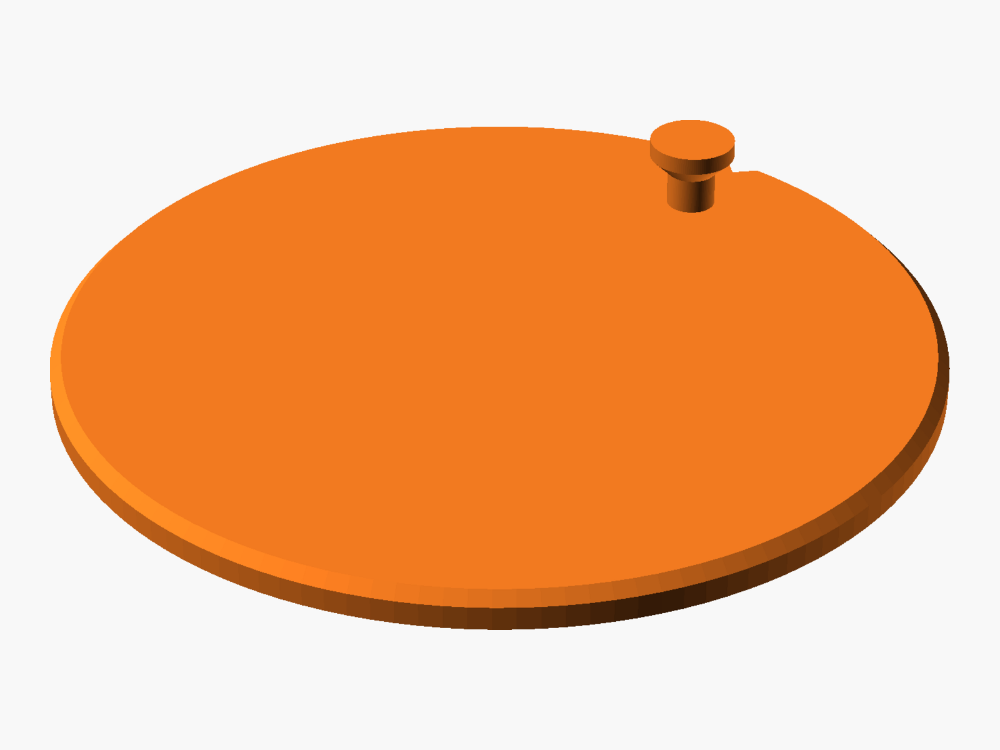

# TIMMERFLOTTE Adhesive Mount

A 3D-printable adhesive mount for the IKEA TIMMERFLOTTE sensor. Stick the round
disc onto tiles (or any other smooth surface) instead of drilling a hole. A
mushroom-head pin on the disc replaces the screw that would normally go into the
keyhole slot on the back of the sensor.



## Download

The STL and preview images are built automatically by GitHub Actions from the
OpenSCAD source:

- **Releases:** every tagged release has the STL and images attached.
- **Latest build:** open the most recent run of the *Build STL and images*
  workflow under *Actions* and download the `stl` or `images` artifact.

## Printing

- Print the disc flat on the bed with the pin pointing up.
- No supports needed: the underside of the pin head has a 45° chamfer.
- Use PETG or ASA for bathrooms and other humid places.

## Mounting

1. Clean and degrease the surface.
2. Attach the disc with double-sided adhesive tape (e.g. a mounting pad cut to
   size). The small notch on the edge marks the top.
3. Hang the sensor by sliding its keyhole slot over the pin.

## Customizing

Open `timmerflotte-adhesive-mount.scad` in [OpenSCAD](https://openscad.org/) and
adjust the parameters at the top of the file. The most important one is
`keyhole_offset`, the distance from the centre of the sensor to the position of
the screw head when the sensor is hung. Measure it on your sensor before
printing.

| Parameter        | Default | Description                                                  |
|------------------|---------|--------------------------------------------------------------|
| `keyhole_offset` | 22.5 mm | Distance from sensor centre to the pin (positive = above)    |
| `head_d`         | 6.0 mm  | Pin head diameter, smaller than the wide part of the keyhole |
| `shank_d`        | 3.4 mm  | Pin shank diameter, smaller than the narrow slot             |
| `standoff`       | 2.5 mm  | Gap between disc and the underside of the head               |
| `head_h`         | 1.2 mm  | Height of the cylindrical part of the head                   |
| `disc_d`         | 60 mm   | Disc diameter                                                |
| `disc_h`         | 2.4 mm  | Disc thickness                                               |
| `mark`           | true    | Alignment notch on the top edge                              |

To render the STL locally:

```sh
openscad -o timmerflotte-adhesive-mount.stl timmerflotte-adhesive-mount.scad
```

To regenerate the preview images in `images/` (needs `openscad`, `xvfb` and
`imagemagick`):

```sh
scripts/render-images.sh
```

## License

Copyright (c) 2026 Daniel A. Spilker

This design is licensed under the
[Creative Commons Attribution 4.0 International License](LICENSE)
(CC BY 4.0). You may use, modify and share it, including commercially, as long
as you give appropriate credit.

## Disclaimer

This project is not affiliated with or endorsed by IKEA. TIMMERFLOTTE and IKEA
are trademarks of Inter IKEA Systems B.V.
